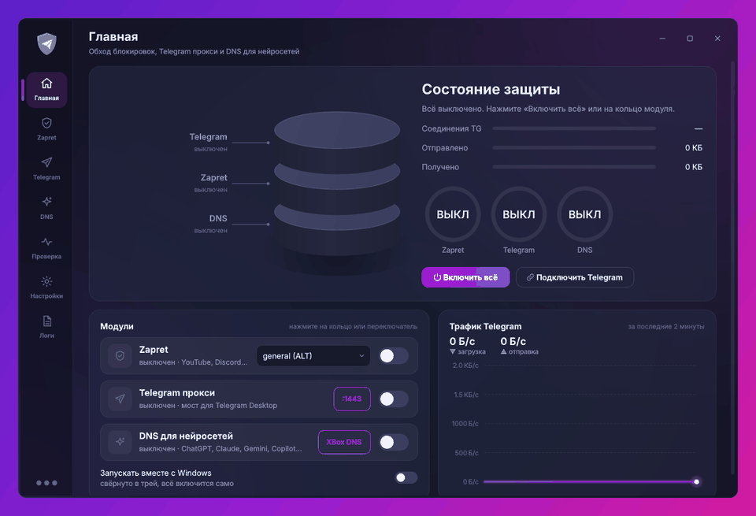

<div align="center">


# ZapretTG

**zapret + Telegram прокси + DNS для нейросетей — в одном приложении для Windows**

Одна кнопка — и открываются YouTube и Discord, Telegram Desktop работает быстро, а ChatGPT, Claude, Gemini и Copilot становятся доступны.

[](https://github.com/tendo432/ZapretTG/actions/workflows/build.yml)
[](https://github.com/tendo432/ZapretTG/releases/latest)
[](https://github.com/tendo432/ZapretTG/releases)
[](LICENSE)
[](SECURITY.md)



</div>

<details>
<summary><b>🇬🇧 English</b></summary>

**ZapretTG** is a Windows app that bundles [zapret](https://github.com/bol-van/zapret) DPI bypass (strategies from [zapret-discord-youtube](https://github.com/Flowseal/zapret-discord-youtube)), [tg-ws-proxy](https://github.com/Flowseal/tg-ws-proxy) for Telegram Desktop and a geo-unblocking DNS for AI services (ChatGPT, Claude, Gemini, Copilot) behind one clean, translucent UI — with tray controls, autostart, auto-recovery and an installer. Upstream code is embedded unchanged.
Download: [installer](https://github.com/tendo432/ZapretTG/releases/latest/download/ZapretTG-Setup.exe) · [single exe](https://github.com/tendo432/ZapretTG/releases/latest/download/ZapretTG.exe) · [portable zip](https://github.com/tendo432/ZapretTG/releases/latest/download/ZapretTG-portable.zip).
</details>

## Установка

Выберите любой способ — все они ставят одну и ту же программу.

| Способ | Для кого | Как |
|---|---|---|
| **Установщик** (рекомендуется) | обычная установка: ярлыки, автозапуск по желанию, удаление через «Приложения» | [ZapretTG-Setup.exe](https://github.com/tendo432/ZapretTG/releases/latest/download/ZapretTG-Setup.exe) → запустить → «Далее» |
| **Одной командой** | быстро, без кликов ([что делает скрипт](scripts/install.ps1)) | PowerShell: `irm https://raw.githubusercontent.com/tendo432/ZapretTG/main/scripts/install.ps1 \| iex` |
| **Один exe** | без установки, носить на флешке | [ZapretTG.exe](https://github.com/tendo432/ZapretTG/releases/latest/download/ZapretTG.exe) → запустить |
| **Portable-папка** | без установки, запускается быстрее одного exe | [ZapretTG-portable.zip](https://github.com/tendo432/ZapretTG/releases/latest/download/ZapretTG-portable.zip) → распаковать → `ZapretTG.exe` |
| **Scoop** | для тех, кто пользуется Scoop | `scoop bucket add zaprettg https://github.com/tendo432/ZapretTG` → `scoop install zaprettg/zaprettg` |
| **Из исходников** | разработчикам | см. [Сборка](#сборка-из-исходников) |

У каждого файла в [релизе](https://github.com/tendo432/ZapretTG/releases) есть SHA-256, ссылка на VirusTotal и аттестация происхождения — как проверить, см. [Безопасность](#безопасность-и-доверие).

### Перед первым запуском

- **Права администратора** нужны драйверу WinDivert — программа запросит их через обычное окно UAC.
- **SmartScreen** может предупредить, что программа не подписана: «Подробнее» → «Выполнить в любом случае». Хотите убедиться в файле — проверьте его хеш и происхождение ([как](SECURITY.md#как-проверить-скачанный-файл)).
- **Антивирус.** ZapretTG **не трогает** настройки Защитника сам. Если Защитник удалит `winws.exe` или драйвер `WinDivert` (это известное ложное срабатывание `HackTool` для всех сборок zapret — [почему](SECURITY.md#почему-антивирус-может-ругаться)), можно по желанию исключить **только две папки `bin`** с этими файлами: галочкой в установщике (по умолчанию выключена), ответом «y» в скрипте установки или кнопкой «Проверка → Исключения Защитника…» в программе.
- Ошибка **«Файл занят другой программой»** — Защитник ещё проверяет exe или поместил его в карантин: подождите 20 секунд или посмотрите «Журнал защиты».

## Что умеет

**Zapret** ([Flowseal/zapret-discord-youtube](https://github.com/Flowseal/zapret-discord-youtube), на основе [bol-van/zapret](https://github.com/bol-van/zapret)) — всё из `service.bat`, но кнопками:
- все стратегии (general, ALT1–13, FAKE TLS AUTO, SIMPLE FAKE…), переключение на лету и из трея; оригинальный тест стратегий;
- запуск через приложение или как **служба Windows**; Game Filter, IPSet, свои списки доменов, замена фейков;
- обновление zapret в один клик с сохранением ваших списков, обновление hosts и ipset;
- диагностика конфликтов (GoodbyeDPI, Killer, Intel Connectivity, Check Point, SmartByte, VPN, Adguard…) с кнопками исправления;
- сторож: если winws.exe упал (сон, смена сети), он поднимается сам; если антивирус удалил файлы — восстанавливаются.

**Telegram прокси** ([Flowseal/tg-ws-proxy](https://github.com/Flowseal/tg-ws-proxy), код встроен без изменений) — все настройки: CF-прокси и Cloudflare Worker с тестами, HTTP/2 для медиа, Fake TLS, PROXY protocol, пул соединений. Кнопка «Подключить Telegram» сразу добавляет прокси в Telegram Desktop. Прокси сам перезапускается после сбоев.

**DNS для нейросетей** — ChatGPT, Claude, Gemini, Copilot, Grok и др. через XBox DNS или Comss.one (или свой DNS):
- «Системный» режим — на Windows 11 сразу с шифрованием DoH, работает и без приложения;
- «Через приложение» — свой DoH-сервер на 127.0.0.1, для Windows 10 и провайдеров, подменяющих DNS;
- прежние DNS адаптеров сохраняются и возвращаются при выключении; проверка «из какой страны вас видят сервисы».

**Приложение** — полупрозрачное окно с размытием фона, тёмная и светлая темы, значок в трее с быстрыми переключателями, автозапуск через планировщик (без запроса UAC), логи, уведомления о сбоях и обновлениях. В фоне почти не нагружает систему.

<p align="center">
  
  
  
  
</p>

## Безопасность и доверие

Программа работает с правами администратора и меняет сетевые настройки, поэтому всё прозрачно и проверяемо — подробности в [SECURITY.md](SECURITY.md).

- **Сборка только автоматическая**: каждый релиз собирается в [GitHub Actions](https://github.com/tendo432/ZapretTG/actions/workflows/build.yml) на чистом Windows из открытого кода и проходит самопроверку. Лог каждой сборки открыт.
- **Чужой код не изменён**: сборка побайтово сверяет встроенные zapret и tg-ws-proxy с оригиналами ([`tools/verify_upstream.py`](tools/verify_upstream.py), коммиты — в [`UPSTREAM.json`](UPSTREAM.json)). Проверить самому: `python tools/verify_upstream.py`.
- **Подлинность файлов**: SHA-256 и VirusTotal у каждого файла в описании релиза; `gh attestation verify ZapretTG-Setup.exe --repo tendo432/ZapretTG` подтверждает, что файл собран здесь и не подменён.
- **Без телеметрии**: никакой аналитики и аккаунтов. Полный список того, куда и зачем подключается программа, — в [SECURITY.md](SECURITY.md#куда-подключается-программа).
- **Всё обратимо**: DNS, службы, автозапуск, hosts и исключения Защитника возвращаются как было при выключении функции или удалении программы.
- **Антивирус — только с вашего согласия** и только для папок с `winws.exe`/WinDivert, а не всей программы.

## Сравнение

ZapretTG не заменяет оригинальные проекты, а объединяет их: стратегии и прокси — те же самые, без изменений. Если вам нужен только один инструмент и вы привыкли к консоли, оригиналы легче и обновляются первыми.

| | **ZapretTG** | [zapret-discord-youtube](https://github.com/Flowseal/zapret-discord-youtube) | [tg-ws-proxy](https://github.com/Flowseal/tg-ws-proxy) | [GoodbyeDPI](https://github.com/ValdikSS/GoodbyeDPI) |
|---|---|---|---|---|
| Обход DPI (YouTube, Discord) | ✅ стратегии zapret-discord-youtube | ✅ | — | ✅ свои режимы |
| Telegram-прокси | ✅ встроенный tg-ws-proxy | — | ✅ | — |
| DNS для нейросетей | ✅ | — | — | — |
| Интерфейс | окно + трей | `.bat`-файлы и консольное меню | значок в трее, окно настроек | консоль, `.cmd`-скрипты |
| Смена стратегии | в один клик, на лету | запуск другого `.bat` | — | параметры запуска |
| Тест стратегий | ✅ оригинальный скрипт | ✅ | — | — |
| Служба Windows | ✅ по желанию | ✅ | — | ✅ скриптом |
| Автозапуск | ✅ планировщик, без UAC | через службу | ✅ | через службу |
| Автоперезапуск после сбоя | ✅ zapret и прокси, с нарастающей паузой | — | перезапуск слушающего сокета | — |
| Установщик / удаление | ✅ Setup, PowerShell, Scoop, portable | архив | exe | архив |
| Размер | ~35 МБ (Python и Qt внутри) | легче | легче | легче всех |
| Открытый код | ✅ MIT | ✅ MIT | ✅ MIT | ✅ Apache-2.0 |

## Частые вопросы

**YouTube/Discord не открываются.** На главной выберите другую стратегию (чаще всего помогают ALT, ALT2, FAKE TLS AUTO) или нажмите «Тест стратегий» — он сам проверит, какие работают у вашего провайдера.

**Telegram не подключается.** Включите прокси и нажмите «Подключить Telegram». Если Telegram не открылся — «Копировать ссылку», отправьте её себе в «Избранное» и нажмите на неё.

**Нейросеть всё равно пишет, что недоступна в регионе.** Перезапустите браузер; выключите в браузере «Безопасный DNS» (или выберите «текущего поставщика»); нажмите «Проверить» на вкладке DNS. Адреса DNS-сервисов иногда меняются — актуальные на их сайтах, их можно указать в «Свой DNS».

**Защитник удалил winws.exe.** «Проверка → Восстановить файлы zapret» вернёт их, а «Исключения Защитника…» (по желанию) не даст удалить снова — см. [SECURITY.md](SECURITY.md#почему-антивирус-может-ругаться).

**Как удалить.** Установщик — через «Параметры → Приложения». Установка командой — `irm https://raw.githubusercontent.com/tendo432/ZapretTG/main/scripts/uninstall.ps1 | iex`. Portable — закройте программу (трей → Выход) и удалите папку. При удалении DNS, автозапуск и службы возвращаются в исходное состояние.

## Где лежат данные

`C:\ProgramData\ZapretTG\` — `config.json` (настройки), `zapret\` (файлы zapret, включая оригинальный `service.bat`), `logs\`.

## Сборка из исходников

```bat
git clone https://github.com/tendo432/ZapretTG && cd ZapretTG
py -3.12 -m pip install -r requirements.txt pyinstaller
py -3.12 run.py                                  :: запуск без сборки
py -3.12 -m PyInstaller ZapretTG.spec            :: dist\ZapretTG.exe
set ONEDIR=1 && py -3.12 -m PyInstaller ZapretTG.spec   :: dist\ZapretTG\ (папка)
```

Релизы собираются автоматически в GitHub Actions на Windows при пуше тега `v*` (exe, portable.zip, установщик, SHA256SUMS) — с самопроверкой каждой сборки. Обновить встроенные утилиты: замените `resources/zapret` новым релизом zapret-discord-youtube, а `vendor/tgws/proxy` — папкой `proxy` из tg-ws-proxy.

## Помочь проекту

- ⭐ Поставьте звезду — так репозиторий быстрее находят другие.
- 🐞 Нашли баг или подобрали стратегию под своего провайдера — напишите в [Issues](https://github.com/tendo432/ZapretTG/issues) или [Обсуждения](https://github.com/tendo432/ZapretTG/discussions).
- 🔧 Pull request'ы приветствуются: `py -3.12 run.py` запускает программу без сборки.

## Благодарности и лицензии

ZapretTG объединяет чужие проекты с открытым кодом, их функции не изменены:
[bol-van/zapret](https://github.com/bol-van/zapret) · [Flowseal/zapret-discord-youtube](https://github.com/Flowseal/zapret-discord-youtube) · [Flowseal/tg-ws-proxy](https://github.com/Flowseal/tg-ws-proxy) (все — MIT).
Код ZapretTG — [MIT](LICENSE).
