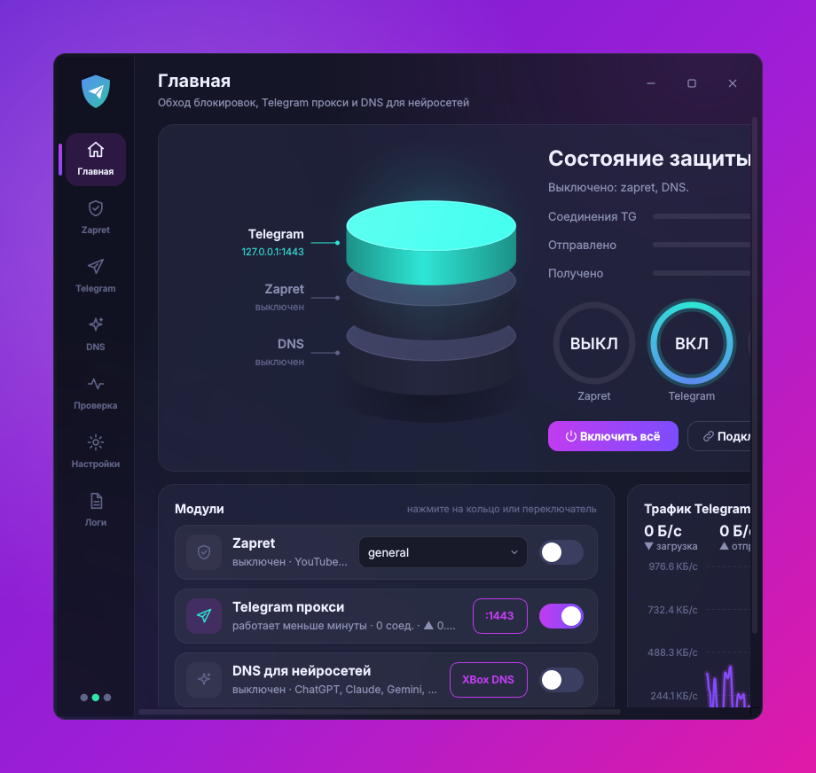
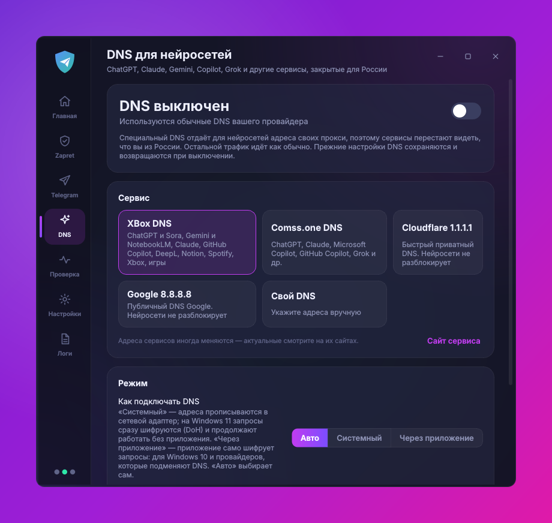
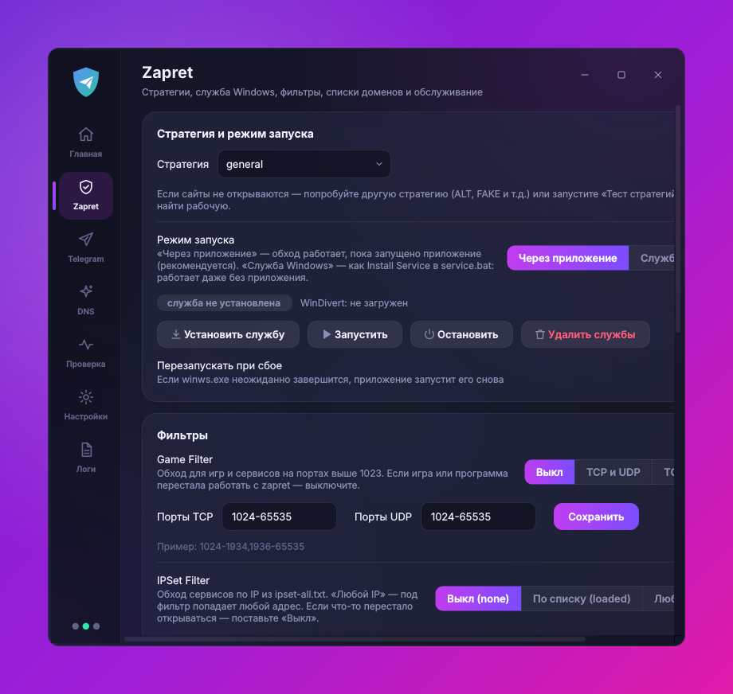
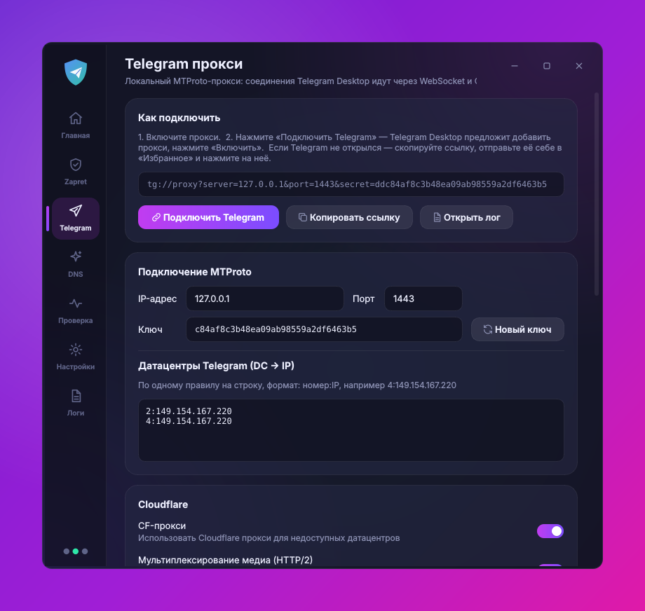
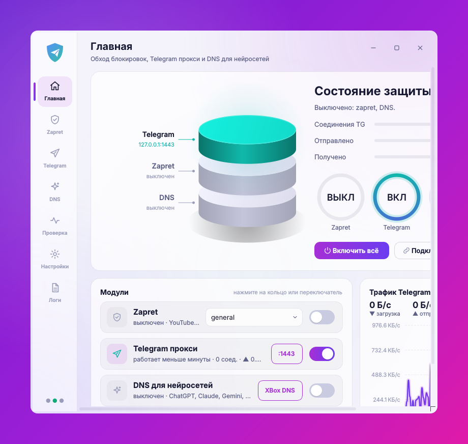

<div align="center">


# ZapretTG

**zapret + Telegram прокси + DNS для нейросетей — в одном приложении для Windows**

Одна кнопка — и открываются YouTube и Discord, Telegram Desktop работает быстро, а ChatGPT, Claude, Gemini и Copilot становятся доступны.

[](https://github.com/tendo432/ZapretTG/actions/workflows/build.yml)
[](https://github.com/tendo432/ZapretTG/releases/latest)
[](https://github.com/tendo432/ZapretTG/releases)



</div>

## Установка

Выберите любой способ — все они ставят одну и ту же программу.

| Способ | Для кого | Как |
|---|---|---|
| **Установщик** (рекомендуется) | обычная установка с ярлыками и удалением через «Приложения» | [ZapretTG-Setup.exe](https://github.com/tendo432/ZapretTG/releases/latest/download/ZapretTG-Setup.exe) → запустить → «Далее» |
| **Одной командой** | быстро, без кликов | PowerShell: `irm https://raw.githubusercontent.com/tendo432/ZapretTG/main/scripts/install.ps1 \| iex` |
| **Один exe** | без установки, носить на флешке | [ZapretTG.exe](https://github.com/tendo432/ZapretTG/releases/latest/download/ZapretTG.exe) → запустить |
| **Portable-папка** | без установки, запускается быстрее одного exe | [ZapretTG-portable.zip](https://github.com/tendo432/ZapretTG/releases/latest/download/ZapretTG-portable.zip) → распаковать → `ZapretTG.exe` |
| **Scoop** | для тех, кто пользуется Scoop | `scoop bucket add zaprettg https://github.com/tendo432/ZapretTG` → `scoop install zaprettg/zaprettg` |
| **Из исходников** | разработчикам | см. [Сборка](#сборка-из-исходников) |

Контрольные суммы всех файлов — в `SHA256SUMS.txt` в каждом [релизе](https://github.com/tendo432/ZapretTG/releases).

### Перед первым запуском

- **Антивирус.** Защитник Windows часто помечает `winws.exe` и драйвер `WinDivert` как «HackTool» и удаляет их — тогда обход перестаёт работать. Это ложное срабатывание (так бывает со всеми сборками zapret). Установщик и команда PowerShell сами добавляют исключения; для exe/zip добавьте вручную папку программы и `C:\ProgramData\ZapretTG` — или нажмите кнопку на вкладке «Проверка».
- **SmartScreen** может предупредить, что программа не подписана: «Подробнее» → «Выполнить в любом случае».
- **Права администратора** нужны драйверу WinDivert — программа запросит их сама.
- Ошибка **«Файл занят другой программой»** при запуске — Защитник ещё проверяет exe или поместил его в карантин: подождите 20 секунд или разрешите файл в «Журнале защиты».

## Что умеет

**Zapret** ([Flowseal/zapret-discord-youtube](https://github.com/Flowseal/zapret-discord-youtube), на основе [bol-van/zapret](https://github.com/bol-van/zapret)) — всё из `service.bat`, но кнопками:
- все стратегии (general, ALT1–13, FAKE TLS AUTO, SIMPLE FAKE…), переключение на лету и из трея; оригинальный тест стратегий;
- запуск через приложение или как **служба Windows**; Game Filter, IPSet, свои списки доменов, замена фейков;
- обновление zapret в один клик с сохранением ваших списков, обновление hosts и ipset;
- диагностика конфликтов (GoodbyeDPI, Killer, Intel Connectivity, Check Point, SmartByte, VPN, Adguard…) с кнопками исправления;
- сторож: если winws.exe упал (сон, смена сети), он поднимается сам; если антивирус удалил файлы — восстанавливаются.

**Telegram прокси** ([Flowseal/tg-ws-proxy](https://github.com/Flowseal/tg-ws-proxy), код встроен без изменений) — все настройки: CF-прокси и Cloudflare Worker с тестами, HTTP/2 для медиа, Fake TLS, PROXY protocol, пул соединений. Кнопка «Подключить Telegram» сразу добавляет прокси в Telegram Desktop. Прокси сам перезапускается после сбоев.

**DNS для нейросетей** — ChatGPT, Claude, Gemini, Copilot, Grok и др. через XBox DNS или Comss.one (или свой DNS):
- «Системный» режим — на Windows 11 сразу с шифрованием DoH, работает и без приложения;
- «Через приложение» — свой DoH-сервер на 127.0.0.1, для Windows 10 и провайдеров, подменяющих DNS;
- прежние DNS адаптеров сохраняются и возвращаются при выключении; проверка «из какой страны вас видят сервисы».

**Приложение** — полупрозрачное окно с размытием фона, тёмная и светлая темы, значок в трее с быстрыми переключателями, автозапуск через планировщик (без запроса UAC), логи, уведомления о сбоях и обновлениях. В фоне почти не нагружает систему.

<p align="center">
  
  
  
  
</p>

## Частые вопросы

**YouTube/Discord не открываются.** На главной выберите другую стратегию (чаще всего помогают ALT, ALT2, FAKE TLS AUTO) или нажмите «Тест стратегий» — он сам проверит, какие работают у вашего провайдера.

**Telegram не подключается.** Включите прокси и нажмите «Подключить Telegram». Если Telegram не открылся — «Копировать ссылку», отправьте её себе в «Избранное» и нажмите на неё.

**Нейросеть всё равно пишет, что недоступна в регионе.** Перезапустите браузер; выключите в браузере «Безопасный DNS» (или выберите «текущего поставщика»); нажмите «Проверить» на вкладке DNS. Адреса DNS-сервисов иногда меняются — актуальные на их сайтах, их можно указать в «Свой DNS».

**Как удалить.** Установщик — через «Параметры → Приложения». Установка командой — `irm https://raw.githubusercontent.com/tendo432/ZapretTG/main/scripts/uninstall.ps1 | iex`. Portable — закройте программу (трей → Выход) и удалите папку. При удалении DNS, автозапуск и службы возвращаются в исходное состояние.

## Где лежат данные

`C:\ProgramData\ZapretTG\` — `config.json` (настройки), `zapret\` (файлы zapret, включая оригинальный `service.bat`), `logs\`.

## Сборка из исходников

```bat
git clone https://github.com/tendo432/ZapretTG && cd ZapretTG
py -3.12 -m pip install -r requirements.txt pyinstaller
py -3.12 run.py                                  :: запуск без сборки
py -3.12 -m PyInstaller ZapretTG.spec            :: dist\ZapretTG.exe
set ONEDIR=1 && py -3.12 -m PyInstaller ZapretTG.spec   :: dist\ZapretTG\ (папка)
```

Релизы собираются автоматически в GitHub Actions на Windows при пуше тега `v*` (exe, portable.zip, установщик, SHA256SUMS) — с самопроверкой каждой сборки. Обновить встроенные утилиты: замените `resources/zapret` новым релизом zapret-discord-youtube, а `vendor/tgws/proxy` — папкой `proxy` из tg-ws-proxy.

## Благодарности и лицензии

ZapretTG объединяет чужие проекты с открытым кодом, их функции не изменены:
[bol-van/zapret](https://github.com/bol-van/zapret) · [Flowseal/zapret-discord-youtube](https://github.com/Flowseal/zapret-discord-youtube) · [Flowseal/tg-ws-proxy](https://github.com/Flowseal/tg-ws-proxy) (все — MIT).
Код ZapretTG — [MIT](LICENSE).
